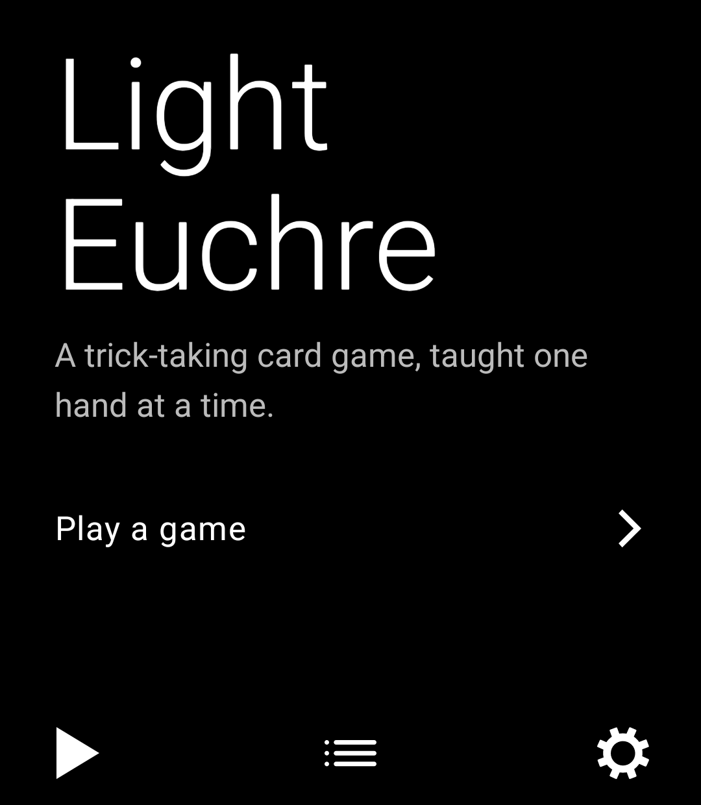
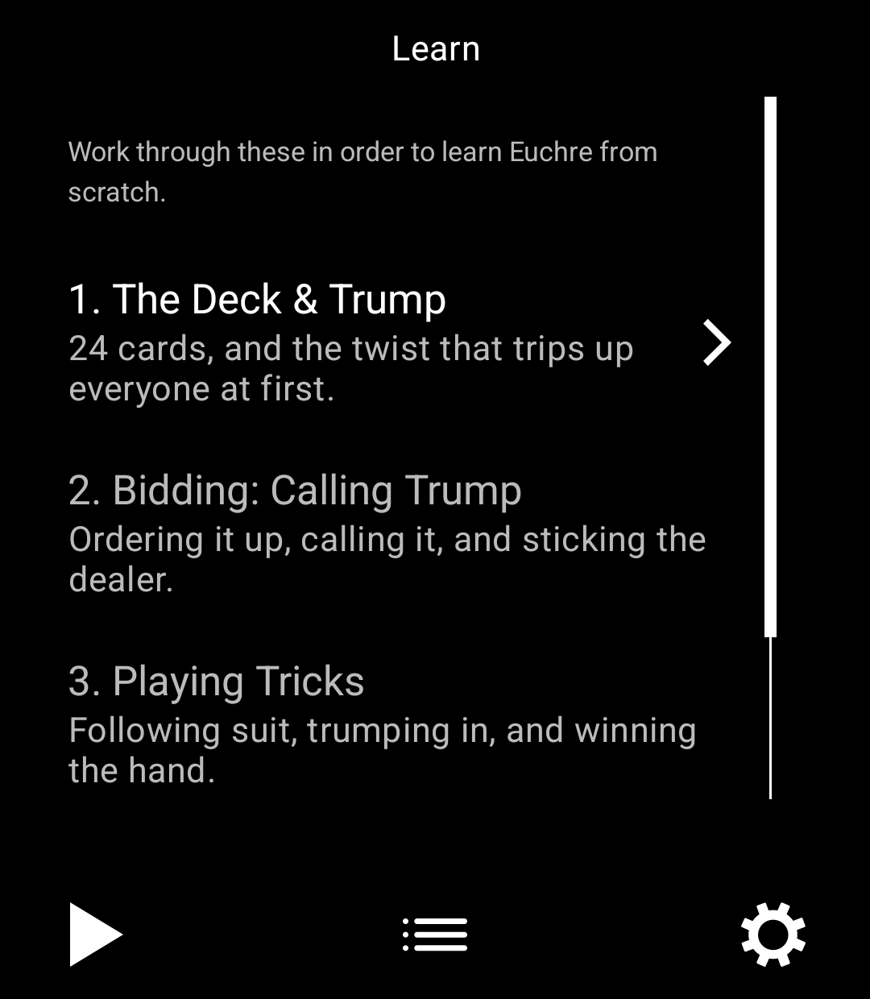
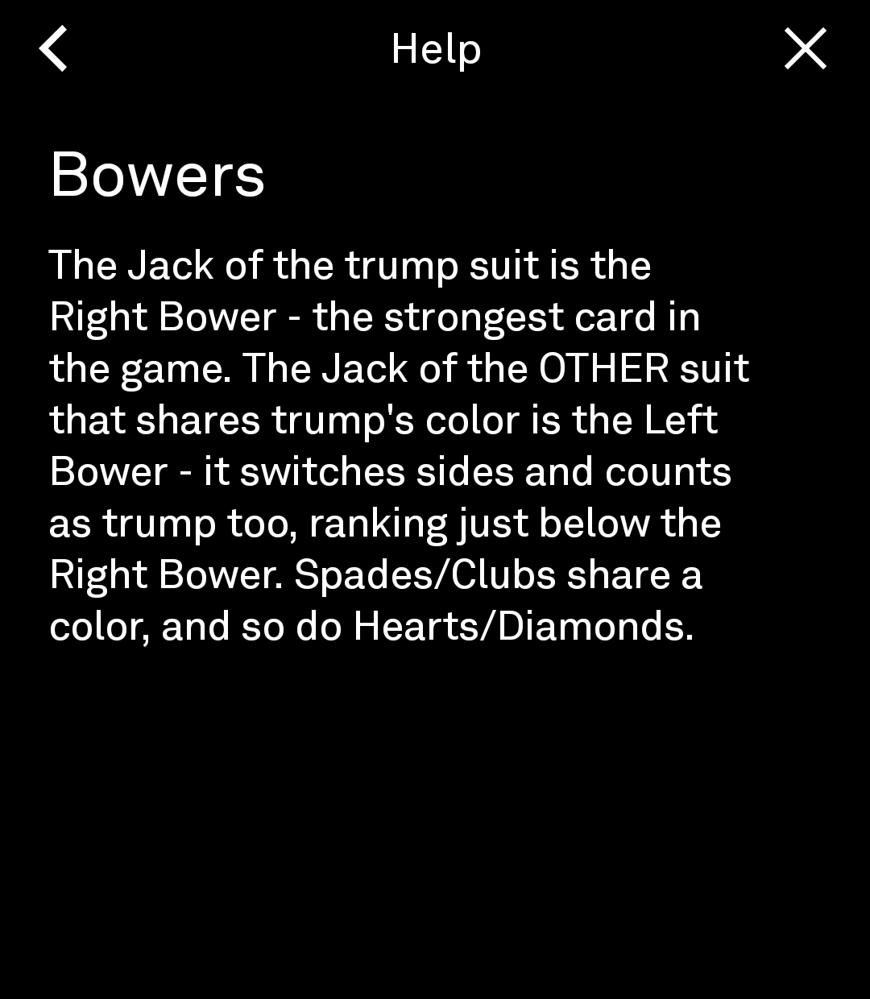

# Light Euchre

A Euchre game and tutorial for the [Light Phone III](https://www.thelightphone.com/), built with the official [Light SDK](https://github.com/lightphone/light-sdk). Learn the rules a few minutes at a time in **Learn**, then play a full four-player game against three AI opponents in **Play** — right down to the trickiest rule in the game (the left bower) and the riskiest call (going alone).

<p align="center">
  
  
  
  
</p>

## What's here

- **A real Euchre engine** — full bidding (order-up, calling round two, sticking the dealer), bower/trump ranking, trick resolution, going alone, and euchre/march scoring. Pure Kotlin, unit tested (`tool/src/test`).
- **A simple heuristic AI** that plays all three opponents automatically, with a short "thinking" pause so hands feel readable rather than instant.
- **Four short lessons** (the deck & trump, bidding, playing tricks, scoring) with interactive quizzes, gated so each unlocks the next as you finish it.
- **An in-game Help screen** — search or browse a glossary of Euchre terms without losing your place in a hand.
- **Progress that persists** locally via Room (lessons completed, games played/won), reset from Settings.

Everything is built from the Light SDK's own primitives (`LightText`, `LightTopBar`, `LightBottomBar`, `LightScrollView`, …), so it reads as a native LightOS tool — monochrome, text-forward, no chrome beyond what the SDK gives you.

## Install the APK

Grab the latest signed build from [Releases](https://github.com/rn-os/light-euchre/releases/latest) and sideload it — or scan this on the Light Phone III's browser to jump straight there:

<p align="center">
  
</p>

## Getting started

```sh
git clone --recurse-submodules https://github.com/rn-os/light-euchre.git
cd light-euchre

# build + install the debug build on a connected device or emulator
./gradlew :tool:installDebug
```

Requirements: Android Studio / SDK with API 34+ available, and either a Light Phone III (in developer mode) or an emulator image matching its spec (1080×1240, API 34, no Google Play Services — see the SDK's own `docs/system_app` for emulator setup). Run tests with `./gradlew :tool:testDebugUnitTest`.

If you cloned without `--recurse-submodules`, run `git submodule update --init --recursive` before building.

## Project structure

```
tool/src/main/kotlin/dev/ryanness/lighteuchre/
├── engine/       Card, Deck, EuchreEngine, EuchreAi — the game rules, no UI
├── tutorial/      Lesson content and the Help glossary
├── data/          Room persistence for learning/game progress
├── ui/            Game, Learn, Settings, Help, Lesson screens
├── HomeScreen.kt  App entry point (@InitialScreen)
└── AboutScreen.kt
```

`engine/EuchreEngine.kt` is a standalone state machine — the entire ruleset (bowers, trumping in, going alone, euchre scoring) is exercised by `tool/src/test/kotlin/.../EuchreEngineTest.kt` independent of any UI.

## Credits

Scaffolded from [garado/light-sdk-template](https://github.com/garado/light-sdk-template), an opinionated starter for Light SDK tools. The `light-sdk` submodule is [lightphone/light-sdk](https://github.com/lightphone/light-sdk), the official SDK.

## License

MIT — see [LICENSE](LICENSE).
